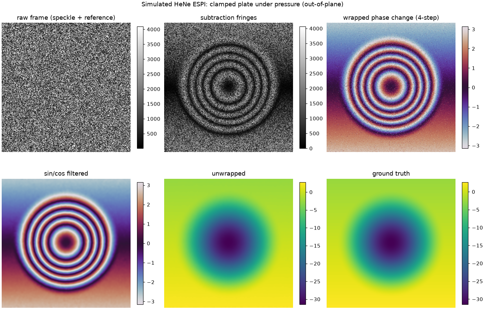
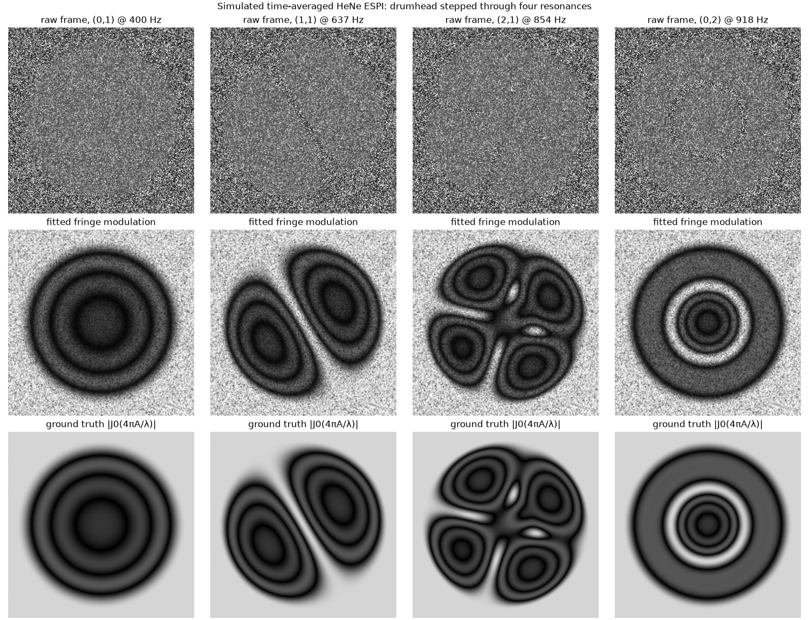

# ESPI Simulation

A physically grounded simulator for **Electronic Speckle Pattern Interferometry**, built to
develop and test ESPI processing code without an optical bench. Every simulated frame comes
with exact ground truth (displacement and phase change at each pixel), so phase extraction,
filtering, unwrapping and strain recovery can be scored quantitatively.

Defaults model a **HeNe laser (632.8 nm)** and a 12-bit machine-vision camera.



## Quick start

```bash
uv sync
uv run pytest                              # 105 physics/unit tests, ~4 s
uv run python examples/bending_plate.py    # writes outputs/bending_plate.png
```

```python
import espi_sim
from espi_sim import analysis as an
from espi_sim.displacement import ClampedPlatePressure

sim = espi_sim.Simulator(espi_sim.SimConfig(camera=espi_sim.Camera(shape=(512, 512)), seed=1))
before, after = sim.acquire_pair(ClampedPlatePressure(radius=7e-3, center_deflection=1.5e-6))

pb = an.phase_from_steps(before.frames, before.phase_steps)   # 4-step PZT by default
pa = an.phase_from_steps(after.frames, after.phase_steps)
recovered = an.unwrap(an.sincos_filter(an.phase_difference(pa.phase, pb.phase), size=7))
error = recovered - after.truth.phase                          # score against ground truth
```

## What it models

| Area | Model |
|---|---|
| Speckle | Rough surface → coherent 4f imaging through a circular pupil. Speckle size `1.22 λ (1+M) F#`, fully developed statistics. |
| Decorrelation | Emerges from the physics. In-plane motion moves the microstructure, and tilt or strain shifts the spectrum within the pupil. |
| Geometry | Out-of-plane (smooth reference) and dual-beam in-plane. Sensitivity vector `(2π/λ)(k̂_ill − k̂_obs)`. |
| Ground truth | Rigid translation/rotation, clamped circular plate (pressure, point load), uniform/thermal strain. Fields superpose with `+`. |
| Phase shifting | PZT steps with miscalibration, quadratic nonlinearity and per-frame vibration jitter. Spatial carrier via a tilted reference. |
| HeNe laser | Single-frequency, or multimode comb (`c/2L` spacing) under a Doppler gain curve: visibility vs path mismatch, mode-sweep phase drift, intensity noise. |
| Camera | Exact pixel-aperture (fill factor) integration, Poisson shot noise, read noise, full-well saturation, gain, bit depth. |
| Determinism | One integer seed, independent named streams per noise source. |

## Time-averaged vibration (drumhead)

Simulate the classic time-averaged ESPI experiment: a drumhead driven by a tone generator
(a fixed tone, a stepped sweep, or a continuous linear or log sweep within one recording),
filmed as video while a reference-arm piezo follows a slow triangle wave. Each frame's
fringe term is weighted by `J0(4πA/λ)`, so nodal lines stay bright and dark rings mark
amplitudes of 121 nm, 278 nm, ….



```python
import numpy as np

drum = espi_sim.Drumhead(radius=0.1, f01=400, q=50)          # ideal clamped membrane
level = drum.calibrate(0.5e-6, at_hz=400)                      # fixed drive strength
cfg = espi_sim.SimConfig(
    camera=espi_sim.Camera(shape=(512, 512)),
    optics=espi_sim.Optics(f_number=8, magnification=512 * 3.45e-6 / 0.22),
    reference_drive=espi_sim.TriangleWave(frequency_hz=0.25, phase_pp=4 * np.pi),
    timing=espi_sim.VideoTiming(frame_rate_hz=30, exposure_s=0.03),
)
video = espi_sim.Simulator(cfg).acquire_video(
    drum, espi_sim.Sweep(350, 1000, duration_s=30, level=level, spacing="log"), n_frames=900
)
# video.frames, video.reference_phase (per frame), video.states[i].amplitude / .modulation (truth)
```

Time averaging uses cycle-averaged fields. The mean field is the image of `U·J0(S·|W|)`,
exact by Jacobi–Anger. The mean intensity averages over vibration phases, which keeps the
speckle smearing from the membrane's slope. Both are cached per distinct tone. A stepped sweep costs one state per step; a continuous sweep costs one per frame (about 0.6 s at 512², so the 900-frame sweep above takes about 9 minutes). Memory is about 9 MB per 512² frame for a continuous sweep (frames, electrons and a truth state per frame). For long recordings, call `acquire_video` in chunks with `frame_offset` and save each chunk: the timeline, reference ramp and noise streams continue seamlessly. The model
assumes steady state and many cycles per exposure, and warns when a sweep is too fast or an
exposure too short. Run `uv run python examples/drumhead_sweep.py` to regenerate the figure.

Output: `Acquisition` objects (frames, noiseless expected electrons, actual phase steps,
ground truth) and `VideoAcquisition` objects. `save_acquisition` and `save_video` write them
as `.npz` for processing code in any language.

Design and rationale: [`docs/superpowers/specs/2026-11-21-espi-simulator-design.md`](docs/superpowers/specs/2026-11-21-espi-simulator-design.md).
